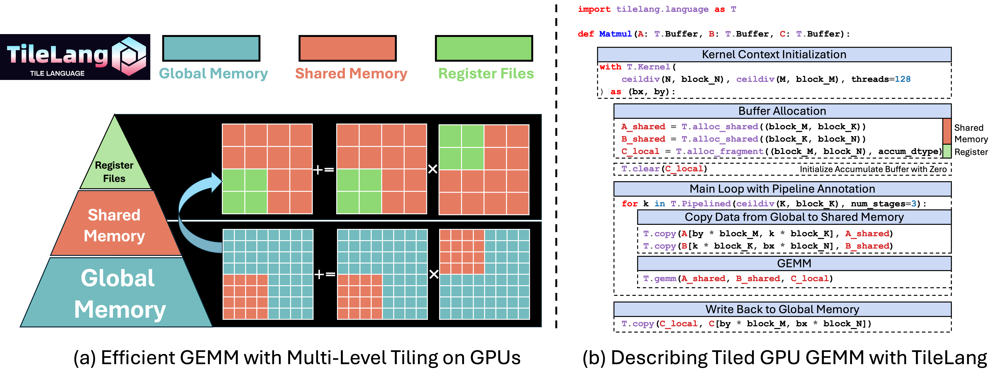

<div align="center">

# Tile Language for DCU (tilelang-dcu)
<!-- [](https://badge.fury.io/py/tilelang-dcu) -->
<!-- [](https://discord.gg/TUrHyJnKPG) -->

</div>

---

**TileLang-DCU** 是专门针对**海光 DCU (Hygon DCU)** 硬件平台定制的高性能内核开发领域特定语言（DSL）。

本顶目基于优秀开源项目 [TileLang](https://github.com/tile-ai/tilelang) 进行深度适配与二次开发。我们继承了 TileLang 简洁的 Pythonic 语法以及基于 [TVM](https://tvm.apache.org/) 的底层编译器基础设施，旨在让开发者能够聚焦于 DCU 算子的高效表达，同时由编译器自动处理低层级的硬件优化，提高在海光DCU平台的算子性能。



## 最新动态 (Latest News)
- **2026/05/21 🎉 [v0.0.1]**: 正式发布第一个预览版本！
  - 成功适配海光 DCU 设备后端。
  - 实现了基础 **NN (Normal-Normal) 布局的高性能 GEMM**（矩阵乘）算子。

## 已测试设备 (Tested Devices)
本分支专注于海光 AI 芯片生态，目前已在以下设备上进行了严格的验证与性能测试：
- **海光 DCU (Hygon DCU)** 

## 核心特性与算子支持
目前 **TileLang-DCU** 处于快速迭代阶段，首期核心聚焦于深度学习中最基础、最核心的计算模式：

- [x] **高性能通用矩阵乘 (GEMM)**: 支持标准 $M \times N \times K$ 规模的 NN 布局（非转置）矩阵乘法。
- [x] **自动化流水线与内存管理**: 继承了 TileLang 的 `T.Pipelined` 与共享内存、片段内存（Shared/Fragment Memory）的高效映射机制。

> **注**：更多高级算子（如转置矩阵乘、Dequant GEMM、FlashAttention 等）及更多布局的优化正在密集开发中。

## 快速安装 (Installation)

### 环境依赖
在编译和使用 TileLang-DCU 之前，请确保您的服务器已正确配置以下环境：
- DTK (Deep Computing ToolKit) 驱动及开发环境
- Python >= 3.8
- CMake >= 3.18

### 从源码安装

```bash
# 1. 克隆本仓库
git clone [https://github.com/your-username/tilelang-dcu.git](https://github.com/your-username/tilelang-dcu.git)
cd tilelang-dcu

# 2. 安装必要的系统依赖
sudo apt-get update
sudo apt-get install -y python3-setuptools gcc libtinfo-dev zlib1g-dev build-essential cmake libedit-dev libxml2-dev

# 3. 以可编辑模式安装 TileLang-DCU
pip install -e . -v
```
## 快速上手 (Quick Start)
以下是一个在海光 DCU 上运行高性能 GEMM (NN 布局) 并带有 ReLU 激活函数的完整示例。语法保持了与原生 TileLang 的高度一致，底层会自动编译为适配 DCU 的 HIP 内核。

```python
@tilelang.jit(out_idx=[-1])
def matmul(M, N, K, block_M, block_N, block_K, dtype=T.float16, accum_dtype=T.float32):
    @T.prim_func
    def gemm(
        A: T.Tensor((M, K), dtype),
        B: T.Tensor((K, N), dtype),
        C: T.Tensor((M, N), dtype),
    ):
        with T.Kernel(T.ceildiv(N, block_N), T.ceildiv(M, block_M), threads=512) as (bx, by):
            A_shared = T.alloc_shared((block_M, block_K), dtype)
            B_shared = T.alloc_shared((block_K, block_N), dtype)
            C_local = T.alloc_fragment((block_M, block_N), accum_dtype)
            T.clear(C_local)
            for k in T.Pipelined(T.ceildiv(K, block_K), num_stages=4):
                T.copy(A[by * block_M, k * block_K], A_shared)
                T.copy(B[k * block_K, bx * block_N], B_shared)
                T.gemm(A_shared, B_shared, C_local)

            T.copy(C_local, C[by * block_M, bx * block_N])

    return gemm

kernel = matmul(5120, 5120, 5120, 256, 256, 16)

import torch

a = torch.randn(5120, 5120).cuda().half()
b = torch.randn(5120, 5120).cuda().half()

c = kernel(a, b)

ref_c = a @ b

print("c:")
print(c)
print("ref_c:")
print(ref_c)
print("CUDA Source:")
print(kernel.get_kernel_source())
profiler = kernel.get_profiler()
latency = profiler.do_bench()
print(f"tilelang Latency: {latency}ms")

torch.testing.assert_close(c, ref_c, rtol=1e-1, atol=1e-1)
print("All check passed.")
```

## 后续规划 (Upcoming Features)
我们正紧锣密鼓地开展后续版本的开发，接下来的规划包括：
1. 支持 NT/TN 等更多输入布局的 GEMM 算子优化。
2. 针对大语言模型（LLM）的 FlashAttention 算子在 DCU 上的全量移植。
